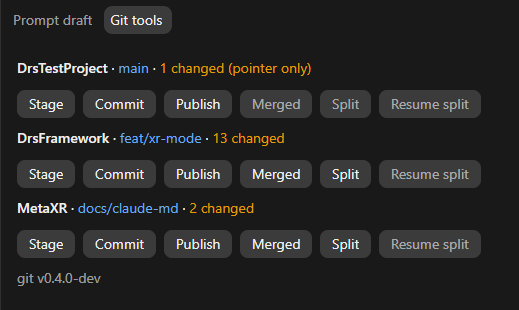

# git

Helpers for using Git across multiple repos inside Claude Code, including commands for common git operations, including slash commands, context menu options and dedicated tools pane.



## Commands

> **The `git:` prefix is optional** unless another plugin, skill or project command uses the same name. For example, `/stage` runs `/git:stage` if nothing else is called `stage`. Use the full name to be sure, and when the typeahead lists more than one match. The pane and the right-click menu always use the full name. `/git-pane` is the exception: it has no `git:` form.

Slash commands that stage, commit, publish and tidy up git branches. They follow each repo's own workflow rules, on top of a set of generic defaults.

| Command | What it does |
| --- | --- |
| `/git:stage [repo]` | Stages every change, including untracked files and submodule pointers. |
| `/git:commit [repo] [-- hint]` | Stages everything and commits, creating a work branch first if needed. |
| `/git:commit-staged [repo] [-- hint]` | Commits only what is already staged. |
| `/git:publish [repo] [-- hint]` | Stages, commits, pushes and opens or updates a PR. New PRs open in the browser. |
| `/git:publish-committed [repo] [-- hint]` | Pushes existing commits and opens or updates a PR. (Any uncommitted changes are excluded.) New PRs open in the browser. |
| `/git:merged [repo] [branch]` | After a PR merges, switches to the default branch, pulls latest and deletes the merged branch. In a submodule, it then offers to update the pointer in the host repo. |
| `/git:split-commits [repo] [-- hint]` | Offers ways to split one change off the uncommitted edits onto a new branch from the default branch. Parks the rest on the current branch and switches to the new one. |
| `/git:split-resume [repo]` | Returns from a split branch to the previous one and restores the parked edits. |
| `/git:prune [repo]` | Deletes the local branches whose PRs have been merged (squash merges included). |

Claude never runs these on its own. They run only when you type them or press one of [the pane](#the-pane)'s buttons.

## Repo selection

Unless a specific repo is specified via the `repo` argument, a command looks at the session's repo and its submodules and acts on the one with relevant changes. If several qualify, it asks you to choose one. `repo` can be a path or a submodule name, such as `/git:commit DrsFramework`. Text after `--` guides the commit or PR wording.

## Branch selection/creation

The commands never commit to the default branch. On the default branch or on a detached HEAD, `commit` and `publish` fork branches of the form `<type>/<kebab-description>` from the remote default branch (with `--no-track`). The first push then makes the branch track its own remote branch. If there is an existing unmerged branch, then this will be reused. If the existing branch's changes look unrelated to the work in progress, the user will be asked to confirm.

## Splitting commits

Sometimes local edits can start to encompass more than what was originally intended, this can lead to large commits and/or PRs that cover multiple items that would be better split into smaller distinct changes. The `/git:split-commits` command looks at the current local edits and suggests ways in which they may be separated. Only one split at a time is suggested and only splits whose edits apply to the remote default branch on their own. Once a split is selected/confirmed the command:

1. parks every other edit on the current branch in a single `park:` commit.
2. creates the new branch from the remote default branch and switches to it, with the split edits unstaged.

Build, test and publish the new branch as usual. Then return with either:

- `/git:merged`, after its PR merges: back to the previous branch, edits restored, the default branch merged in;
- `/git:split-resume`, without merging: back to the previous branch, edits restored.

Every `/git:` command refuses to work on a parked branch, and a session start says when edits are parked. If you switch back by hand, `/git:split-resume` (or `git reset HEAD~1` on the park commit) restores them. Until they are restored, `refs/drs-split/<branch>` keeps a backup of every edit as it was before the split. Submodule pointers always stay behind, and the commands don't stage them on a split branch.

## Git tools pane

`/git-pane` opens the Git tools pane beside the chat. It shows the session's repo and each of its submodules:

- **A line for each repo**, with the branch (or `detached`), how many files have changed, whether the only change is a submodule pointer, and how many commits are still to publish. A split branch is tagged `split from <branch>`.
- **A warning** for a submodule pointer whose commit isn't on that submodule's default branch, naming the branch it is on. A submodule's default branch is the one `.gitmodules` tracks (`branch = …`), or else its remote's.
- **Buttons** for Stage, Commit, Publish, Merged, Split and Resume split. Ones that don't apply are greyed out, and pressing the button will explain why. On a branch with parked edits, only Resume split applies.

Each button runs its `/git:` command for that repo, as if you'd typed it, so the command's rule and judgement apply. The pane refreshes after every turn and every 15 seconds while it is shown.

In the desktop app, the right-click menu provides an option to open the tools pane ("Open Git tools"). If the pane is currently closed, then it lists every available command along with a one-line description of what it does. While the pane is open, the menu includes only the commands that the pane has no button for. Commands from the menu choose their repo the same waya typed command does. The pane's footer shows the installed version.

## Workflow rules

The plugin's default rules are in [`shared/defaults.md`](shared/defaults.md): Conventional Commits, branch names, PR title and description, and safety rules (no force-push, `--ff-only` pulls).

A repo adds its own rules by linking a git workflow document from its `CLAUDE.md`, for example ``Follow [`Docs/GitWorkflow.md`](Docs/GitWorkflow.md)``. That document overrides the defaults where they differ. Tip: a project's GitWorkflow.md should not assume the existence of this plugin. It should stand alone without it. It can also say, in plain prose:

- how to choose a repo when several have changes;
- checks to run before committing or publishing;
- extra PR description sections;
- a different base branch or staging rule.

## Prerequisites

- `git` and `bash` (Git Bash on Windows).
- `gh`, signed in (`gh auth login`), for `publish`, `publish-committed`, `merged` and `prune`, and for squash-merge detection.

## Installing

Install for every repo (user scope):

```
claude plugin install git@drs-claude-tools --scope user
```

Or for one project only, shared with its collaborators through `.claude/settings.json`:

```
claude plugin install git@drs-claude-tools --scope project
```

See the [marketplace README](../../README.md) for adding the marketplace.

The commands are allowed to run `git` and `gh` without asking while they run. To block force-pushes in all cases, add `Bash(git push --force*)` and `Bash(git push -f*)` to `permissions.deny` in your settings.
