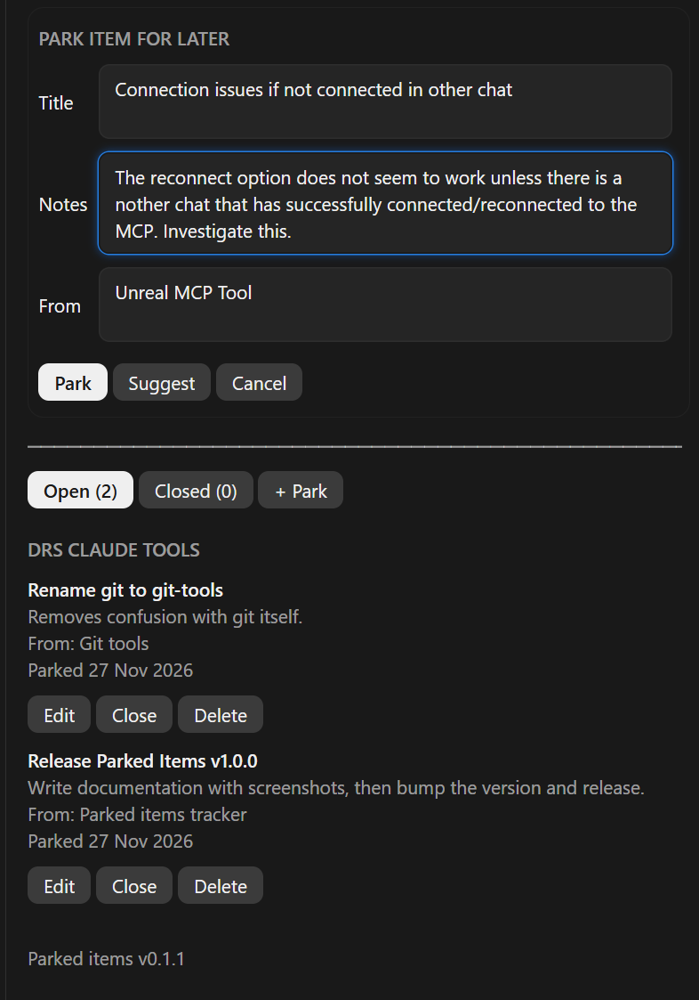
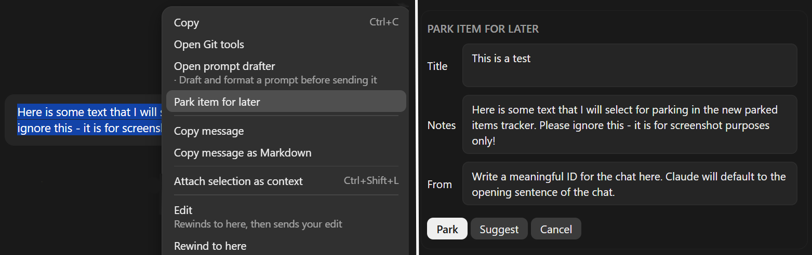

# Parked Items

Claude has a tendency to fire all kinds of options at you all at once - more than any human can deal with immediately. Inevitably you will need to skip or defer things until you're ready. If you are working in multiple sessions in parallel then it becomes all too easy to lose track of things you meant to pick up later.

This plugin allows you to 'park' suggestions from any Claude Code chat, and find them again later in one place. For example, you might want to defer something because it is blocked, you are busy with something else, or you want to think about it some more before acting on it.

Parked items are tracked and presented in a convenient side-pane where you can edit, close or delete them as necessary - all organised by repository.

<p align="center">
  
  <br>
  <em>Parked items dialog and open items pane.</em>
</p>

<p align="center">
  
  <br>
  <em>Example of parking an item from selected text.</em>
</p>

## Usage

Parking an item:
- **`/park`** opens the park dialog in the side pane, with Title, Notes and From fields. The optional From field is for noting which chat the parked item came from. Anything you type after the command becomes the title: `/park Fix the flaky login test`. Press **Park** to save it. Nothing is saved until you do.
- **Right-click → Park item for later** (desktop app) opens the same dialog with the Notes field automatically populated with any text you have highlighted in the chat. You then need to provide the title.
- **+ Park** in the side pane opens the same dialog with all fields empty.
- **Suggest** asks Claude to automatically deduce what you might want to park from the contents of the chat, then supplies some options for you to choose from. Selecting one of these will automatically populate the Title and Notes fields for you.
- **Claude offers** to park follow-up items when it recognises from the chat that a decision has been made to defer some work. Off by default (see Settings).

Viewing parked items:
- **`/parked`** opens the Parked items pane.
- While anything is parked, a reminder line above the prompt box will display something like **◷ 2 parked issues (3 total)**. This gives an overview of the open items from the current project, and the open items across all projects. Click it to open the Parked items side pane. The reminder automatically hides while the pane is already open.
- The Parked items pane lists your items grouped by project, with **Open** and **Closed** tabs. It refreshes the list whenever you open it, or if you press the **↻** button.

For each parked item you can:
- **Edit** its Title, Notes and From fields.
- **Close** it when the deferred work is done. (It moves to the Closed tab from where it can be reopened.)
- **Delete** it permanently.

## Settings

- **Claude offers to park follow-ups** (off by default). While enabled, Claude can offer to park items it identified from the chat as being deferred. It can then open the park dialog itself. This incurs the cost of a tool and short instruction to every Claude request, about 300 tokens, mostly served from the prompt cache. Set it when you install the mod, or later in Claude Code's config menu (`/config`). A change applies from the next chat you start.

## Privacy

The list is stored on your own computer, by Claude Code, for this mod only. Nothing is sent anywhere, apart from the
request to Claude that suggests what to park, which uses your normal Claude session.

## Known issues & limitations
- It is not currently possible to link the parked items back to the chat from which they were spawned. The mod does track the session IDs, but it is not currently possible to use this to open the chat or fork a new chat from it.
- Custom session titles are not visible to the mod - it can only retrieve the chat's opening request text.

## Installation

In a terminal Claude Code session:

```
/plugin install parked-items --marketplace DrStevenWright/DrsClaudeTools
```

In the desktop app: click **+** next to the prompt box, then **Plugins**, **Add marketplace** with `DrStevenWright/DrsClaudeTools`, then **Add plugin**.

Choose the **user** scope to have your parked items in every session.

## License

MIT
