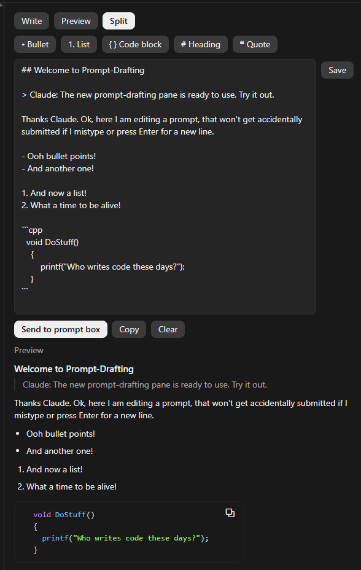

# prompt-drafter

One of the annoying things about Claude is that the universal key for line return (Enter) is instead interpreted as an instruction to submit the current prompt in whatever state it is in. For me at least, this happens quite frequently and wastes tokens. Arguably, prompts do not need human-readable formatting; but humans reading and editing those prompts do, and it is in this area that the standard Claude interface is sadly lacking.

The following mod for Claude Code seeks to address some of these flaws, within the limits imposed by Claude's API. It provides a side-pane for editing prompts without the risk of accidentally sending them before you are ready. You can add line returns, bullet points, lists, code and quote blocks to your heart's content, and then send it to the prompt box with the click of a button when ready. This is especially helpful when drafting long and/or complex prompts.



> **Experimental.** This mod is built on Claude Code's mod API, which is marked early access and may change between releases without notice. An update to Claude Code may break the pane until the mod is updated.

## Installation

In a terminal Claude Code session:

```
/plugin install prompt-drafter --marketplace DrStevenWright/DrsClaudeTools
```

In the desktop app: click **+** next to the prompt box, then **Plugins**, **Add marketplace** with `DrStevenWright/DrsClaudeTools`, then **Add plugin**.

Choose the **user** scope to have the drafter in every session.

## Usage

1. **Open the pane.** Type `/draft` in the prompt window, or right-click anywhere in the conversation and select **Open prompt drafter** from the context menu. The context menu item only appears while the pane isn't on screen (i.e. when the pane is closed, hidden, or behind another tab).
2. **Write your prompt** in the editor. You still need to press **Shift+Enter** to start a new line (it is not currently possible to reassign the Enter key). However, **Enter** now only saves the draft, and does not submit anything, whether deliberately or accidentally.
3. **Format it** with Markdown, either by typing it (`- `, `1. `, `## `, `> `, ```` ``` ````) or with the toolbar buttons, which add the appropriate Markdown syntax to the end of the draft for you.
4. **Check it** on the **Preview** tab, or use **Split** to see the preview alongside the draft.
5. **Send it.** **Send to prompt box** moves the draft into the normal message box and clears the pane. Review it there and press Enter to send it to Claude.

Your draft is saved as you type and comes back in later sessions, so you can close the pane and return to it. The **✕ Close** button, as you would expect, closes the pane. (Hiding the side panel only hides the pane and does not close it.)

## Draft pane at a glance

**Tabs row**

| Tab | Shows |
| --- | --- |
| **Write** (default) | The editor alone, sized to fill the pane, so the mouse wheel only scrolls your draft. Best for long prompts. |
| **Preview** | The draft rendered as Markdown, exactly as Claude will read it. |
| **Split** | The editor with a live preview underneath, as in the picture above. The preview catches up shortly after you stop typing. |
| **Close** | Saves the draft and closes the pane. |

The tab you pick is remembered, and switching tabs keeps your text.

**Toolbar row**

| Button | Adds |
| --- | --- |
| **• Bullet** | Bullet point: `- `. |
| **1. List** | Next numbered item: `1. `, or `3. ` after a `2. ` line, keeping its indentation. |
| **{ } Code block** | Fenced code block, labelled `cpp`. Change the label to `text`, `log` or another language as needed. |
| **# Heading** | Heading: `## `. |
| **❝ Quote** | Quoted line: `> `. Press again for another quoted line. |

**Bottom row**

| Button | Does |
| --- | --- |
| **Send to prompt box** | Replaces whatever is in the message box with the draft, then clears the pane. Nothing is sent until you press Enter. |
| **Copy** | Copies the draft to the clipboard. |
| **Clear** | Empties the draft. |

**Tips**

- **Quotes need to be followed by a blank line** to prevent them swallowing the subsequent text, so press **Shift+Enter twice** before carrying on with normal text. The formatting buttons here will automatically add one for you.
- **Pasting logs or compiler errors:** use a code block rather than a quote. Text in a code block is kept exactly as pasted, while `*`, `_` and `#` inside a quote are read as formatting.

## Attachments

Often a prompt will need to refer to a specific attachment. Although you cannot add attachments to the draft, you can still add the attachments in the normal prompt box, either before or after you send your draft to the prompt box.

## Known issues and limitations

These come from the limitations of Claude's mod API at the time of writing:

- **Desktop and terminal only.** Claude's mobile app does not currently support the prompt drafter pane, and probably does not need it since it already distinguishes line returns from send (different buttons on the keyboard in IOS).
- **It is not a WYSIWYG editor.** You type Markdown into a plain-text field and see it rendered in the Preview or Split tab. Mods can't draw a rich-text field.
- **Toolbar buttons only add at the end of the draft.** A mod isn't told where the cursor is or what text is selected, so a button can't insert at the cursor or wrap a selection (for example, quote the selected lines).
- **Lists don't continue automatically.** Shift+Enter after a list item gives a plain new line; type the next `- ` yourself or press the button. Continuing lists while typing was tried and removed, because rewriting the text while you type made the cursor jump and missed some keystrokes.
- **The Save button beside the editor takes some width.** It's drawn by Claude Code to show what Enter does. A mod can only change its wording, not move or hide it.
- **Split mode can make the pane scroll.** With a long draft the preview makes the pane taller than its window, so the mouse wheel may scroll the pane instead of the editor. Use the Write tab for long drafts.
- **One draft at a time.** There's a single saved draft, shared by all sessions. Two sessions drafting at once overwrite each other's saved copy.

## Development

The tests run with:

```
claude plugin test plugins/prompt-drafter
```

The right-click menu test needs a Claude Code recent enough to know the right-click menu: 2.1.326 works, 2.1.321 doesn't.
