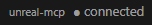

# unreal-mcp

Helper plugin for connecting Claude Code to Unreal Editor's MCP server, and displaying the current connection status underneath the prompt. For example:



By default, Claude Code connects to the Unreal Editor only when a chat starts, so opening the editor afterwards means starting over. With this plugin, Claude connects to the MCP automatically whenever the editor comes up. If the connection failed for whatever reason, the status line will explain why and how to reconnect (usually a matter of selecting "Reconnect" on the Unreal mcp connector).

## Engine version
This tool was developed and tested for UE 5.8 (where the MCP plugins are currently experimental).

## Prerequisites
Your Unreal project needs the editor's MCP server running.

1. **Enable the plugins.** In the editor, open **Edit > Plugins** and enable:
   - **Unreal MCP** (`ModelContextProtocol`): required. This is the MCP server itself.
   - **All Toolsets** (`AllToolsets`): recommended. It gives Claude the editor's tools (actors, assets, Blueprints and so on); without it there is little to use.
   - Restart the editor when asked.
2. **Start the server automatically.** Open **Edit > Editor Preferences > General > Model Context Protocol** and tick **Auto Start Server**. This is a personal setting, saved per project on your machine, so everyone using the project sets it once. Alternatively, run `ModelContextProtocol.StartServer` in the editor's console each time you open the editor.
3. **Leave the port at 8000**, set on the same page as **Server Port Number**, unless you need another. If you change it, you will need to change the plugin's port to match (see [Changing the port](#changing-the-port)).

Do NOT run the editor's `ModelContextProtocol.GenerateClientConfig ClaudeCode` command. It writes an `unreal-mcp` entry into the project's `.mcp.json`, which this plugin doesn't need and can actually cause problems (see [If you've already set up Unreal's MCP](#if-youve-already-set-up-unreals-mcp)).

## Installation

Install it in **one** of these two ways.

- **In a terminal session**, type this at the prompt:

  ```
  /plugin install unreal-mcp --marketplace DrStevenWright/DrsClaudeTools
  ```

- **In the desktop app**, click + next to the prompt box, then Plugins, then Add marketplace with `DrStevenWright/DrsClaudeTools`, then Add plugin.

When asked where to install it, choose **project** to turn it on for this Unreal project only, or **user** for all your projects. It stays hidden in folders that aren't Unreal projects.

**Important:** the plugin brings its own connection to the editor, called **Unreal MCP**. Don't also add a server for the editor yourself or the connection won't work properly and every editor tool will appear twice.

### If you've already set up Unreal's MCP

If you followed Unreal's own setup, or added the server with `claude mcp add`, remove that server first. Deleting the project's `.mcp.json` isn't always enough, because `claude mcp add` keeps servers in your own Claude Code settings instead.

1. In the project folder, run:

   ```
   claude mcp list
   ```

2. Look for any server at `http://127.0.0.1:8000/mcp` (or your editor's port) other than `plugin:unreal-mcp:unreal-mcp`, and remove it:
   - If it's in the project's `.mcp.json`, which is where the editor's `GenerateClientConfig` command puts it, delete its entry, or the whole file if that's the only entry.
   - Otherwise, remove it with `claude mcp remove`, using the name from the list. Try `-s local` first, which is where `claude mcp add` puts a server by default, then `-s user`:

     ```
     claude mcp remove unreal-mcp -s local
     ```

3. Start a new session.

## Using the plugin

Start the Unreal Editor, then start Claude Code in the project folder. The status line under the prompt should read `unreal-mcp ● connected`.

If you start Claude Code first, that's fine - once the editor is up, Claude Code usually connects by itself. If the connection attempt times out, the status line will eventually ask you to reconnect. When it does so, press **Reconnect** on **Unreal MCP** under Connectors (in the terminal, use `/mcp`).

| Status line (after `unreal-mcp`) | What to do |
| --- | --- |
| `● connected` | Nothing: it's working. |
| `◐ editor up · connecting…` | Wait: Claude Code is connecting. |
| `◐ editor up · not connected ⓘ` | Press **Reconnect** on **Unreal MCP**. If the message mentions `.mcp.json`, remove the project's `unreal-mcp` entry and start a new session. If Reconnect doesn't help, check for another copy of the server (see [If you've already set up Unreal's MCP](#if-youve-already-set-up-unreals-mcp)). |
| `○ offline` | Start the editor. |
| `○ URL not set ⓘ` | Set the **Unreal Editor MCP URL** (see [Changing the port](#changing-the-port)), then start a new session. |
| `◐ connected · editor busy` or `○ editor busy` | Wait: the editor is compiling, cooking or showing a dialog. |
| `⚠ connected twice ⓘ` | Remove the other copy of the server, from the project's `.mcp.json` or with `claude mcp remove` (see [If you've already set up Unreal's MCP](#if-youve-already-set-up-unreals-mcp)), then start a new session. |
| `○ invalid .mcp.json ⓘ` | Fix the project's `.mcp.json`. The message gives the line and column. |

`ⓘ` is accompanied by a short pop-up message explaining the connection status and how to proceed. The status line updates every 15 to 30 seconds, and stays empty in folders that aren't Unreal projects.

If **Unreal MCP** isn't listed under Connectors, start a new chat in the project folder. (A chat started before the plugin was installed or updated won't have the connector.)

If the status line stays empty in an Unreal project, run `claude mcp list` in the project folder. If `plugin:unreal-mcp:unreal-mcp` isn't listed, the plugin either isn't installed or isn't enabled for this project.

## Changing the port

The plugin expects the editor's MCP server at `http://127.0.0.1:8000/mcp`. If your editor uses a different port, change the **Unreal Editor MCP URL** setting (`endpoint_url`) with `/plugin configure unreal-mcp@drs-claude-tools` in a terminal session, or from PowerShell:

```
'{"endpoint_url":"http://127.0.0.1:8001/mcp"}' | claude plugin configure unreal-mcp@drs-claude-tools --values-stdin
```

Then start a new session, or press **Reconnect** on **Unreal MCP**.

## Checking the version

Type `/unreal-mcp` to see the installed version, the connection status and the URL being checked. For example:

```
unreal-mcp v1.0.0 · ● connected · http://127.0.0.1:8000/mcp
```
